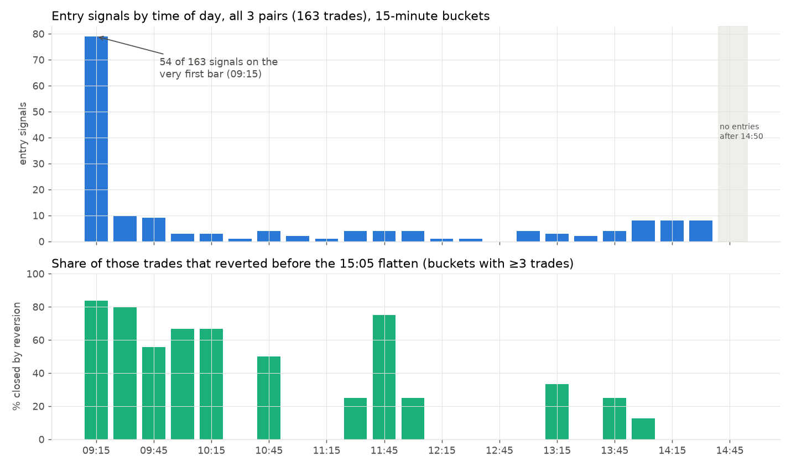
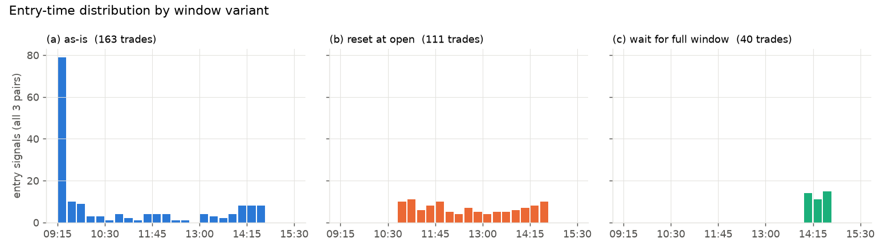
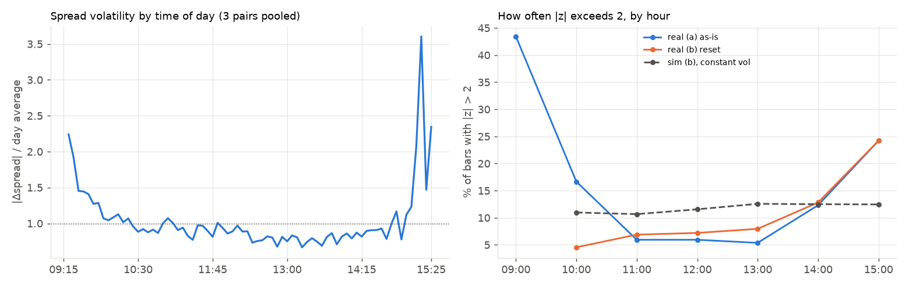

# Intraday Statistical Arbitrage (Pairs Trading) on NSE Equities

A four-phase pairs-trading research project on 5-minute NSE bars:
cointegration-based pair selection → walk-forward z-score strategy → Indian
transaction-cost model → GARCH(1,1) volatility-adjusted thresholds.

It extends coursework on ADF testing, OLS, rolling-window backtesting and GARCH.
Every method here builds on those. Kalman-filter hedge ratios and other more
advanced methods are deliberately left out.

> **Headline result (data 9-Jul-2026 → 30-Sep-2026):** none of the three candidate
> pairs is cointegrated at 5% once the correct Engle-Granger critical values are used.
> The strategy run on the closest candidate (SBIN/BANKBARODA, EG p = 0.11) makes
> +1.3% gross over 44 trading days but **−3.7% after realistic NSE costs**.
> The GARCH-adjusted thresholds don't change that picture. These are honest negative
> results from a short sample, and the reasons behind them are the interesting part (see *Findings*).
>
> **Diagnostics (notebook 05):** the gross Sharpe of 0.26 has a standard error of ~2.4 (95% CI −4.2 to +5.7),
> so it is indistinguishable from zero. Half of all entries are the *overnight gap* measured against
> yesterday's calm afternoon, and reaching z = 0 takes ~2 spread half-lives, more than a whole session.
> Three ablations (window reset, exit rules, a half-life entry cutoff) explain the behaviour but
> none survives costs.

---

## Interactive simulator (web app)

`app.py` is a Streamlit app that runs the same engine in a browser:

- **Pair test:** hedge ratio, ADF vs Engle-Granger p-values, half-life, spread chart
- **Simulation replay:** pick a day and step (or ▶ play) through it bar by bar. It shows prices, z-score,
  thresholds, entries and exits, intraday P&L, and a plain-English account of what the engine does on each bar
  (mark to market → fill → decide)
- **Results & costs:** fixed vs GARCH vs buy & hold, equity and drawdown, round-trip cost breakdown, slippage sweep
- **GARCH:** parameter evolution and adaptive thresholds
- Sidebar: choose a preset or any custom NSE pair, and change thresholds, windows, notional and slippage

```bash
streamlit run app.py
```

It downloads the latest ~60 days from Yahoo Finance when opened, so no data is stored in the repo.

## Project structure

```
data/
  raw/                     yfinance OHLCV per ticker (parquet, cached)
  processed/               cleaned + aligned pair prices (parquet)
src/
  data_pipeline.py         fetch, clean, align bars; formation/trading split
  cointegration.py         Phase 1: correlation pre-screen, Engle-Granger, ADF
  strategy.py              Phase 2: walk-forward spread/z-score, backtest engine, buy & hold
  costs.py                 Phase 3: NSE intraday cost model
  garch_thresholds.py      Phase 4: rolling ARCH/GARCH fits, adaptive thresholds, parameter plots
  backtest_report.py       shared metrics, comparison tables, plots (used by every phase)
  experiments.py           diagnostics and ablations: window variants, seasonality, OU passage times
app.py                     interactive Streamlit simulator
notebooks/
  01_pair_selection.ipynb
  02_baseline_strategy.ipynb
  03_cost_analysis.ipynb
  04_garch_thresholds.ipynb
  05_diagnostics.ipynb     why the strategy behaves as it does (review questions Q1-Q9)
analysis/
  q5_predictions.md        pre-registered predictions for the window experiment (committed before running)
  q5_results.md            results scored against those predictions
  figures/                 charts used in this README
```

Every tunable number is a named constant in the `CONFIG` block at the top of its module.

## Reproducing the results

```bash
python -m venv .venv
.venv/Scripts/activate            # Windows  (source .venv/bin/activate on macOS/Linux)
pip install -r requirements.txt
python src/data_pipeline.py       # uses cached parquet in data/raw if present
jupyter notebook notebooks/       # run 01 → 04 in order
```

The notebooks are committed **with their outputs**, so every table and chart quoted in
this README can be read on GitHub without running anything.

The price data itself is **not** in the repository (Yahoo's terms don't allow
redistributing it). The first run downloads the latest ~60 days and caches them in
`data/raw`, and later runs reuse that cache. Since yfinance only serves a rolling 60-day
window, your numbers will differ from the ones below (data 9-Jul-2026 → 30-Sep-2026).
The method and code are identical. Call `load_pair(..., refresh=True)` to re-download.

---

## Data limitations (read first)

| Issue | Consequence | Mitigation |
|---|---|---|
| yfinance 5m history is capped at ~60 calendar days | ~59 trading days total, 44 in the backtest. Too short for strong statistical claims; a single bad week dominates | Treat results as a methodology demonstration. A paid NSE feed (or broker API history) drops in by replacing `fetch_ticker` |
| No bid/ask, only last-trade bar closes | Slippage can't be measured, only assumed | Slippage is a parameter; notebook 03 sweeps 0–10 bps |
| Missing bars, especially the last 2–3 of the session (data ends 15:10 or 15:15 on ~45% of days) | A 15:15 exit would often never fire | Scheduled flatten at 15:05, plus a safety close on the last available bar |
| Inner-join alignment drops bars missing for either leg | A few bars lost | Deliberately no forward-fill, which would create fake spread moves |
| The 60-day window rolls daily | Re-downloading changes the sample | Raw data is cached to parquet |

---

## Phase 1: Pair selection & cointegration (`cointegration.py`, notebook 01)

1. **Formation/trading split.** Pairs are selected on the first `FORMATION_DAYS = 15`
   trading days only. All backtests run on the days after. Testing and trading on the
   same data would be selection lookahead bias.
2. **Correlation pre-screen.** Rolling 375-bar (~5-day) price correlation, average ≥ 0.60.
   This is a weak filter by design: correlated trending series can be non-cointegrated
   (spurious regression).
3. **Engle-Granger step 1.** OLS `A = α + β·B + ε`; β is the hedge ratio.
4. **Engle-Granger step 2.** ADF (`adfuller`, constant, AIC lag selection) on ε.
   H0 = unit root (non-stationary, so not cointegrated). p < 0.05 means reject, i.e. the spread mean-reverts.
5. **Critical values matter.** Because OLS chooses β to make ε as stationary-looking as possible,
   plain ADF critical values are too lenient. The table reports both the plain `adfuller` p-value
   and the Engle-Granger (MacKinnon) p-value from `statsmodels.coint`. The decision uses the latter
   (`USE_ENGLE_GRANGER_PVALUE`).
6. The AR(1) **half-life** of the spread is reported as a sanity check against the 60-bar z-window.

| Pair (formation period) | Hedge ratio | ADF stat | ADF p | EG p | Cointegrated |
|---|---|---|---|---|---|
| HDFCBANK/ICICIBANK | −1.035 | −1.46 | 0.551 | 0.774 | N |
| TCS/INFY | 2.079 | −1.47 | 0.546 | 0.774 | N |
| SBIN/BANKBARODA | 3.030 | −3.00 | **0.035** | 0.111 | N |

SBIN/BANKBARODA is the textbook trap: the naive ADF says "cointegrated", the correct
Engle-Granger test says "not proven". Since no pair passes, `ALLOW_FALLBACK_TO_BEST_PAIR = True`
runs later phases on the lowest-p pair **for demonstration only**. Set it to `False` for the
strict behaviour, in which nothing proceeds.

*The SBIN partner (BANKBARODA) is a placeholder. Change `CANDIDATE_PAIRS` in `data_pipeline.py`.*

## Phase 2: Baseline z-score strategy (`strategy.py`, notebook 02)

- **Walk-forward hedge ratio:** β is refit each morning by OLS on the previous `HEDGE_LOOKBACK_DAYS = 10` days.
  This is the rolling-ARIMA idea: fit on a trailing window, then apply forward.
- **Spread / z-score:** `spread_t = A_t − β_d·B_t`; z over a rolling `ZSCORE_WINDOW = 60` bars ending at t.
  Bars in the window from earlier days are recomputed with today's β so the window has consistent units.
- **Signals:** long spread if z < −2, short spread if z > +2, exit when z crosses back through `EXIT_Z = 0`.
- **Sizing:** dollar-neutral, ₹5 lakh long and ₹5 lakh short (whole shares). Net market exposure is ~0,
  so sector-wide moves cancel and P&L comes from the relative move. A `hedge_ratio` mode
  (β shares of B per share of A) is also available. The two coincide only when the OLS intercept is ~0.
- **No lookahead:** signal on bar t's close, fill on bar t+1's close (`EXECUTION_LAG_BARS = 1`).
- **Intraday only:** no new entries after 14:50, flatten at 15:05/15:10. Retail can't carry cash-equity
  shorts overnight in India, and brokers auto-square-off MIS positions around 15:20.
- **Metrics:** total/annualised return, Sharpe on *daily* excess returns vs a 6.5% Indian T-bill rate
  (per-bar Sharpe on autocorrelated 5m returns would be inflated), max drawdown, win rate,
  trade count, average holding period.

SBIN/BANKBARODA, gross: **+1.29%**, Sharpe 0.26, max DD −1.48%, 59 trades, 64% win rate, ~2.5 h average hold.

**Mean P&L by exit reason** (`signal` = z reverted to 0; `eod` = closed by the 15:05 flatten):

| Pair | Exit | Trades | Mean gross P&L | Mean net P&L | Mean bars held |
|---|---|---|---|---|---|
| HDFCBANK/ICICIBANK | signal | 30 | +₹1,010 | +₹164 | 37 |
| | eod | 22 | −₹1,495 | −₹2,341 | 32 |
| TCS/INFY | signal | 32 | +₹898 | +₹53 | 30 |
| | eod | 20 | −₹2,351 | −₹3,195 | 42 |
| SBIN/BANKBARODA | signal | 33 | +₹1,201 | +₹355 | 29 |
| | eod | 26 | −₹1,029 | −₹1,875 | 31 |
| **All 3 pairs** | signal | 95 | +₹1,039 | +₹193 | 32 |
| | eod | 68 | −₹1,569 | −₹2,414 | 35 |

Trades that revert make money even after costs; trades the clock closes lose. The exit label is the
symptom. The cause is how much session is left at entry relative to the Phase 1 half-life (46 bars on
SBIN/BANKBARODA): trades with more than one half-life left reverted 79% of the time, those with less only
14% (notebook 05, section 1).

## Phase 3: Transaction costs (`costs.py`, notebook 03)

Per fill, for NSE intraday (MIS): brokerage min(0.03%, ₹20); STT 0.025% **sell side only**;
NSE transaction charge 0.00297%; SEBI ₹10/crore; stamp duty 0.003% **buy side only**;
GST 18% on brokerage + exchange + SEBI; slippage `SLIPPAGE_BPS = 2` per fill.

**Why 2 bps slippage, not the US 3 bps:** these are NIFTY-50 names with a 1-tick quoted spread
(~0.3–1 bp of price), so crossing half the spread costs < 0.5 bp. Our ₹5 lakh orders have negligible
impact. The rest is a buffer for the bar-close → fill gap and the thinner leg. Since yfinance has
no quotes, notebook 03 shows the full 0–10 bps sweep.

One round trip (4 fills, ₹5 lakh per leg) costs **₹847 ≈ 16.9 bps of one leg**: slippage 8.0, STT 5.0,
brokerage 1.6, exchange 1.2, other 1.1.

| SBIN/BANKBARODA | Before costs | After costs |
|---|---|---|
| Total return | 1.29% | −3.70% |
| Sharpe | 0.26 | −6.17 |
| Win rate | 64.4% | 42.4% |
| Avg P&L per trade | ₹218 | −₹628 |
| Total costs | | ₹49,923 (388% of gross P&L) |
| Excess-return degradation (ann.) | | −27.1 pts |

Even at **0 bps slippage** the strategy loses 1.35%. Statutory charges alone (~9 bps per round trip)
exceed the ~4.4 bps average gross edge per trade.

## Phase 4: GARCH-adjusted thresholds (`garch_thresholds.py`, notebook 04)

1. **Series:** spread "returns" = `(ΔA − β·ΔB) / A_{t−1}` in bps. These are first differences, because the
   spread level can be near zero or negative, which makes % returns meaningless. β is held fixed within
   each fit to avoid artificial jumps. Overnight returns are dropped (18 hours of news is not a 5-minute shock).
2. **ADF first:** spread level p = 0.68 (non-stationary over the trading period); spread returns p ≈ 0 (stationary), so GARCH is appropriate.
3. **Walk-forward GARCH:** each morning, fit ARCH(1) and GARCH(1,1) (`arch`, constant mean, normal errors)
   on the previous 15 days. Then run the variance recursion `σ²_{t+1} = ω + α·ε²_t + β·σ²_t` **by hand**
   through the day with fixed parameters, giving a one-step-ahead forecast at each bar that uses data up to t only.
4. **Adaptive threshold:** `entry_t = 2 × clip(σ̂_t / σ̄, 0.5, 2.0)`, where σ̄ is the average forecast over the fit window.
5. **Parameter-evolution plot:** ARCH α vs GARCH α, GARCH β, and persistence (α+β) across the 44 daily refits.

| SBIN/BANKBARODA, after costs | Fixed threshold | GARCH threshold | Buy & hold |
|---|---|---|---|
| Total return | −3.70% | −4.11% | −5.26% |
| Sharpe | −6.17 | −6.61 | −2.12 |
| Max drawdown | −4.54% | −4.93% | −12.72% |
| Trades | 59 | 57 | 1 |

Across all three pairs the GARCH variant helped on TCS/INFY (−6.2% → −5.2%) and slightly hurt on the
other two. That is not a consistent improvement.

---

## Diagnostics & ablations (`experiments.py`, notebook 05)

Two rounds of review questions, answered with the same engine and data. Each Sharpe below has a
standard error of ~2.4 over 44 days, so differences between variants are noise unless stated otherwise.

### How certain is the Sharpe? (Q4)

| SBIN/BANKBARODA, gross | Value |
|---|---|
| Sharpe (daily excess returns, annualised) | 0.26 |
| Standard error, Lo (2002) / bootstrap | 2.39 / 2.50 |
| 95% bootstrap CI | −4.16 to +5.69 |
| P(Sharpe ≤ 0), bootstrap | 45% |
| Trading days needed for SE = 0.5 | ~1,000 (~4 years) |

The point estimate isn't defensible. It is also the best of three pairs (selection bias) and before costs.

### What is the signal reacting to? (Q1, Q2)



- At the signal bar the 60-bar z-window holds a median of **4 bars from today** (all pairs); 33% of signals
  fire on the 09:15 bar, when 59 of the 60 bars are from yesterday.
- At the open the spread jumps by the **overnight relative move** (5–9× a normal 5-minute change), and it is
  divided by a std built from **yesterday's calm afternoon**. Large numerator, small denominator.
- Part of the "reversion" is mechanical: for SBIN/BANKBARODA open-bar trades, a median 58% of the gap closed
  because the rolling mean moved toward the spread (35% for other trades).
- Afternoon entries are ordinary deviations with too little session left: 8% of trades signalled after 12:45 reverted.

### Window experiment (Q5): predictions pre-registered

Predictions were committed and pushed before running ([`analysis/q5_predictions.md`](analysis/q5_predictions.md));
the scored comparison is in [`analysis/q5_results.md`](analysis/q5_results.md) (7 of 12 right, 3 half right, 2 wrong).

| SBIN/BANKBARODA | (a) as-is | (b) reset at open | (c) wait for full window |
|---|---|---|---|
| Trades | 59 | 34 | 13 |
| Gross / net return | +1.29% / −3.70% | −0.93% / −3.80% | +1.68% / +0.58% |
| Gross / net Sharpe | 0.26 / −6.17 | −3.33 / −7.56 | 1.35 / −1.28 |
| Median entry signal | 09:40 | 12:45 | 14:20 |
| Exits by reversion | 56% | 26% | 8% |



(b) removes the gap trades and replaces them with worse-timed ones; the first bars after its 20-bar warm-up
are the worst group. (c)'s positive return on SBIN rests on one trade (51% of the total, t = 1.72) and doesn't
appear on the other pairs (pooled t = 0.67): noise.

### Intraday volatility seasonality (Q6)



Spread volatility is **U-shaped**: ~2× midday in the first 30 minutes, a trough around 13:00, rising again into
the close (the spike after 15:10 rests on fewer days, since yfinance often drops those bars). A properly
standardised z should exceed 2 equally often at every hour; a constant-volatility simulation with the same
windows gives a flat ~12%. With the window reset at the open, the real data go from 4.5% (10:00) to 13% (14:00)
to 24% (15:00). **Resetting removes the overnight gap but not the seasonality**: the z-score would need a
bar-of-day volatility adjustment (deseasonalised "volatility time"), which is the natural next experiment.

### How long does reversion take? (Q7)

Treating the standardised spread as an Ornstein-Uhlenbeck process, the expected first-passage time from z₀ to z₁ is
`T = (1/θ)·√(π/2)·∫_{z₁}^{z₀} e^{u²/2} erfc(u/√2) du`, with θ = ln 2 / half-life (checked by Monte Carlo):

| From → to | No noise | OU (half-lives) | Bars at HL = 46 | P(done within one half-life) |
|---|---|---|---|---|
| 2 → 0 | never | 2.06 | ~95 | 20% |
| 2 → 0.5 | 2.00 | 1.30 | ~60 | 43% |

A session has 70 tradeable bars. Exits tested on all pairs: **|z| ≤ 0.5** raises the reversion share
(56% → 71% on SBIN) with small, mixed changes in return; a **time stop at one half-life** does nothing on the
two pairs whose half-life is longer than a session, and slightly worse on SBIN.

### Half-life entry rule (Q8)

Enter only if at least **k × half-life** bars remain before the 15:05 flatten (clock-based, half-life from the
formation period). The theory says k ≈ 2 for a z = 0 exit, which would never trade, so **k = 1** is the
loosest defensible value (also where the Q3 split sits, so it isn't out-of-sample).

| SBIN/BANKBARODA | Trades | Gross | Net | Reverted |
|---|---|---|---|---|
| Fixed 14:50 cutoff (baseline) | 59 | +1.29% | −3.70% | 56% |
| k = 1 (entries until ~11:15) | 38 | +1.18% | −2.04% | 79% |
| k = 1.3 + exit at \|z\| ≤ 0.5 | 34 | +1.63% | −1.25% | 97% |

On HDFCBANK/ICICIBANK and TCS/INFY (half-lives 133 and 328 bars) the rule allows **no trades**, which is
the right answer: those spreads don't revert on an intraday horizon. k = 1.5 looks best on SBIN (net +0.4%) but
only allows entries at 09:15–09:20, so it silently becomes the overnight-gap trade again.

---

## Findings worth discussing

1. **Cointegration on a few weeks of 5-minute data is fragile.** Rolling 10-day Engle-Granger p-values move between
   0.01 and 0.97 from one window to the next for the same pair. Intraday "cointegration" is not a stable property here.
2. **The naive-ADF trap is real.** One pair would have passed with plain ADF critical values and failed with the correct ones.
3. **Costs, not signal quality, decide the result.** The gross win rate is 64%, but the average reversion
   (~4 bps of notional) is smaller than one round trip's cost (~17 bps). To survive, the strategy would need wider
   entry bands (fewer, bigger trades), lower slippage, or a longer holding horizon.
4. **The intraday constraint bites.** 26 of 59 trades were closed by the 15:05 flatten, not by reversion, and
   those lose money on average. Reaching z = 0 takes ~2 half-lives (~95 bars on SBIN) against 70 tradeable
   bars, and the half-life predicts which trades revert far better than any signal property.
5. **GARCH vol is not very persistent here.** α+β ranges ~0.2–1.0 and is often well below the ~0.95+ typical of daily stock
   returns, so the adaptive threshold mostly tracks the last few bars. The vol ratio's median (0.91) is below 1,
   so the adaptive band is usually *tighter* than ±2 and trades about as often as the fixed one.
6. **Dollar-neutral vs β-neutral.** The signal uses a β-weighted spread while positions are rupee-neutral, so the P&L doesn't
   track the traded spread exactly when α ≠ 0. This is a known trade-off, switchable via `SIZING_MODE`.
7. **Half the signal is the overnight gap.** A rolling window that spans days compares the open with yesterday's
   afternoon. Resetting it removes that, but the U-shaped intraday volatility still distorts z.
8. **The Sharpe ratio can't carry a conclusion here.** SE ≈ 2.4 on 44 days. The robust finding is the cost one:
   the average gross edge (~4 bps per trade) is below the round-trip cost (~17 bps) for every pair and variant.

## Natural extensions (not implemented, by design)

- Longer, cleaner data (paid NSE feed) and a proper multi-window out-of-sample evaluation
- Johansen test for multi-asset baskets; Kalman-filter dynamic hedge ratios
- Bar-of-day volatility adjustment of the z-score (the Q6 finding); stop-loss on |z|; Student-t GARCH errors
- Threshold optimisation with a separate validation period (to avoid overfitting the 44-day sample)

## License

Released under the [MIT License](LICENSE). This is a research and learning project, not investment advice.
